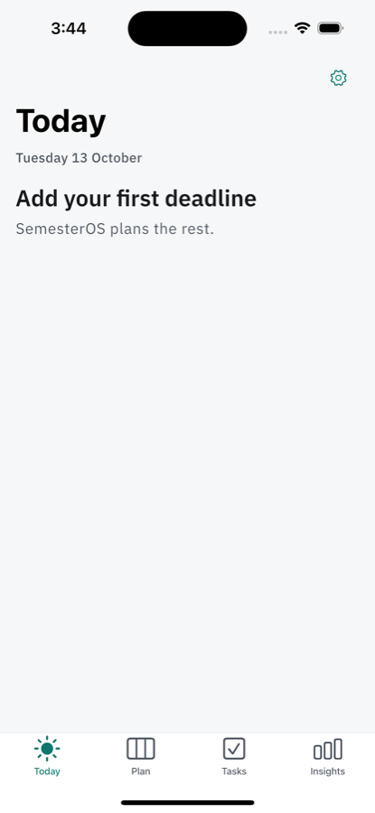
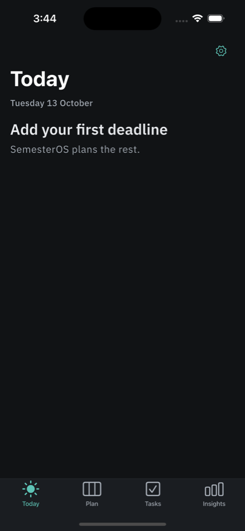
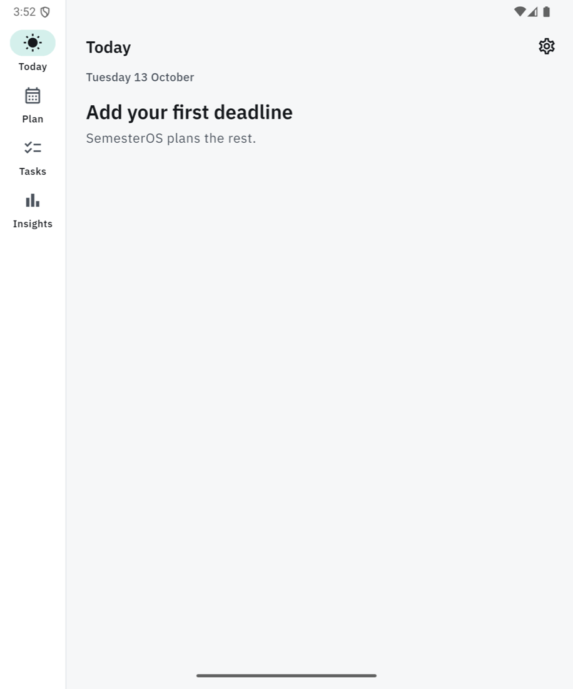

# SemesterOS

> Know what matters. Know what to do next. Stay in control of your semester.

SemesterOS is an offline-first study planner for Android phones and tablets, iPhones and iPads. You add your deadlines and the times you can study; it builds a realistic plan, tells you what to work on next, tracks your study sessions, and warns you early and plainly when the work does not fit.

<p>
  
  
  
</p>

<sub>Real captures from the current build: iPhone 15 simulator (iOS 17.5) and a Pixel Fold emulator (Android 15), 13 October 2026.</sub>

## Status

**Early development: Phase 1 (foundation) is done; Phase 2 (database and core data) is in progress.** The phase plan with every checklist item and its verified result is in [docs/IMPLEMENTATION_PLAN.md](docs/IMPLEMENTATION_PLAN.md).

Works today:

- The app shell on both platforms: Today, Plan, Tasks and Insights, adapted per platform (iOS tab bar and large titles; Android navigation bar, rail or drawer by window size), light and dark themes, landscape phones and text scaled to 200 %.
- Today's layout with the date line and the next-action block; Settings with About & diagnostics, opening inside the current tab.
- The on-device database (schema v1) with integrity checks before it opens, a recovery screen, and coded, privacy-safe error handling.

Not built yet: subjects and tasks, quick add, the scheduler, the planner, study sessions, insights, reminders and backups. They arrive phase by phase.

## What makes it different

1. **Explained, never silent.** Every plan is a proposal you accept. Nothing moves on its own, and every session can say why it is there.
2. **Private, no account.** Everything stays on your device. No sign-up, no network requests for features, no data sent anywhere.
3. **Learns your real pace.** Estimates adjust to how long your tasks actually take.
4. **Honest about capacity.** When the work does not fit your time, it says so early and plainly, and offers concrete ways out, without guilt.

## Privacy and your data

- Your data lives in a SQLite database on the device. There is **no cloud sync** in v1 and the app talks to no server.
- A JSON backup you save and restore yourself arrives in Phase 7. Your phone's own OS backup (Google or iCloud, under your account) may also copy the database; SemesterOS itself sends nothing.

## Platforms and design

- **Adaptive by platform:** iOS follows Apple's Human Interface Guidelines (tab bar, large titles, inset grouped lists, the system font for controls); Android follows Material 3. One set of tokens drives both. See [docs/DESIGN_SYSTEM.md](docs/DESIGN_SYSTEM.md) §13.
- **Typeface:** IBM Plex Sans (SIL OFL), bundled in the app, never downloaded.
- **Accessibility:** every text and status color pair is contrast-tested in both themes, status is never shown by color alone, layouts are tested at text scale 2.0 including landscape, and touch targets are at least 44 pt (iOS) or 48 dp (Android).

## Tech stack

| Area | Choice |
|---|---|
| App | Flutter 3.47.7 / Dart 3.13.5, Android and iOS |
| State | Riverpod 3 (no code generation) |
| Navigation | go_router with per-tab stacks |
| Database | Drift over bundled SQLite (`sqlite3`), schema snapshots in `drift_schemas/` |
| Scheduling | `packages/semester_scheduler`, a pure Dart package with no Flutter or database imports |
| Charts | fl_chart (Phase 5) |

Every dependency was checked for license, publisher and account requirements before it was added; the list with versions is in [docs/ARCHITECTURE.md](docs/ARCHITECTURE.md) §4.

## Getting started

### Prerequisites

- Flutter **3.47.7** (Dart 3.13.5), pinned in `.fvmrc` and `pubspec.yaml`. Use [fvm](https://fvm.app) (`fvm use 3.47.7`) or put that SDK's `bin` on your PATH.
- Android: the Android SDK and JDK 17+. The first build installs the SDK platform and CMake it needs.
- iOS (macOS only): Xcode 26 with its matching iOS platform installed (Xcode > Settings > Components, or `xcodebuild -downloadPlatform iOS`). CocoaPods is not needed; plugins resolve through Swift Package Manager.
- No accounts, API keys or paid services are needed to build, run or test.

### Set up

```bash
./tool/bootstrap.sh
```

Checks the Flutter version, gets packages for the app and the scheduler package, generates Drift code (generated files are not committed), and prints anything still missing on your machine with the exact fix. On a fresh clone it takes about 35 seconds.

### Run

```bash
flutter run
```

### Test

```bash
./tool/check.sh
```

Runs exactly what CI runs: the version pin check, `dart format`, `flutter analyze`, the app tests and the scheduler package tests (with `TZ=America/New_York`). Golden image tests are compared on macOS only:

```bash
flutter test --tags golden
```

Other scripts: `tool/gen.sh` (code generation only) and `tool/test_integration.sh <device-id>` (the integration journey, from Phase 4).

### Build

```bash
flutter build apk --debug
```

```bash
flutter build ios --simulator --no-codesign
```

Release builds and store publishing are covered in Phase 9.

## Project layout

```
lib/
  app/                         app entry, router, theme tokens
  core/                        database (Drift, DbGuard), errors, time, config (AppLimits), shared widgets
  features/<feature>/          presentation / application / domain / data
packages/semester_scheduler/   pure Dart scheduling engine
test/                          unit, widget, schema and golden tests
drift_schemas/                 committed database schema snapshots
assets/fonts/                  IBM Plex Sans and its licence
tool/                          bootstrap, check, gen, test_integration
docs/                          plan, architecture, scheduling, design system, UX flows, responsive, errors
.claude/                       the agent workflow used to build the project (see below)
```

Layer rules are enforced by a test: presentation code never imports the data layer or Drift, and the scheduler package never imports Flutter or Drift.

## How the project is built

Work follows [docs/IMPLEMENTATION_PLAN.md](docs/IMPLEMENTATION_PLAN.md), one checklist item at a time. Each item has a **Verify** step, and an item only counts as done when that verification has run and its result is recorded next to it.

The repo includes the agent workflow used for this with Claude Code: `/harness <item>` (`.claude/commands/harness.md`) has a developer agent implement the item, an independent read-only QA agent check every Verify clause, and an ops agent record the result and commit. Lessons from earlier runs live in [LEARNING.md](LEARNING.md). Screens also pass a design review on real simulators before a phase closes.

## Continuous integration

GitHub Actions (`.github/workflows/ci.yml`) runs `tool/check.sh` and a debug APK build on every push to `main` and on pull requests.

## Documentation

| Document | What it covers |
|---|---|
| [PRODUCT.md](PRODUCT.md) | users, purpose, core promises, principles |
| [docs/IMPLEMENTATION_PLAN.md](docs/IMPLEMENTATION_PLAN.md) | phases, checklists, verified results, decisions |
| [docs/ARCHITECTURE.md](docs/ARCHITECTURE.md) | layers, database schema, time model, planning flow |
| [docs/SCHEDULING_ALGORITHM.md](docs/SCHEDULING_ALGORITHM.md) | how plans are built and scored |
| [docs/DESIGN_SYSTEM.md](docs/DESIGN_SYSTEM.md) | colors, type, components, platform mapping |
| [docs/UX_FLOWS.md](docs/UX_FLOWS.md) | screens, states and copy |
| [docs/RESPONSIVE_DESIGN.md](docs/RESPONSIVE_DESIGN.md) | layouts by window size |
| [docs/ERRORS.md](docs/ERRORS.md) | error codes and messages |
| [CHANGELOG.md](CHANGELOG.md) | what changed, by phase |

## Roadmap

| Phase | Scope |
|---|---|
| 1 | Foundation: shell, theme, errors, database skeleton, tooling (done) |
| 2 | Database and core data: subjects, tasks, quick add, settings (in progress) |
| 3 | Scheduling engine |
| 4 | Today, planner and study sessions |
| 5 | Rescheduling and insights |
| 6 | Responsive design and polish |
| 7 | Reminders and backups |
| 8 | Quality assurance |
| 9 | Release preparation |

Ideas deferred beyond v1 (calendar import, a semester archive, a home-screen widget, desktop and web) are in [TODOS.md](TODOS.md).

## Known limitations

- Early development: most features are not built yet (see Status).
- Golden image tests run on macOS only and are not part of `tool/check.sh`.
- Verified on simulators and emulators only so far, not on physical devices.

## Costs

Building, running and testing SemesterOS costs nothing: no backend, no paid APIs, no subscriptions. Publishing is optional and separate: the Google Play developer registration (one-time fee) and the Apple Developer Program (annual fee) are needed only to distribute through the stores.

## License

No license has been chosen yet; it is decided in Phase 9. Until then the code is not licensed for reuse.
